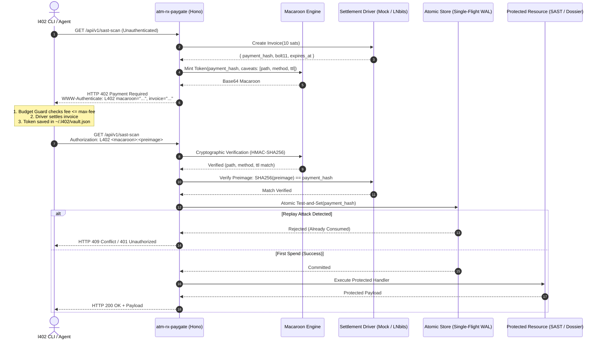

# atm-rx-paygate / atm-rx-l402

[](https://www.typescriptlang.org/)
[](https://github.com/lightning/blips/blob/master/blip-0010.md)
[](#hardware-footprint)
[](LICENSE)

> **The "curl" of the Sovereign Machine-to-Machine Economy.**  
> An ultra-lightweight, zero-bloat L402 (HTTP 402 Payment Required) reverse-proxy gateway and autonomous client CLI engineered for low-spec hardware and edge deployments.

Developed by **Brandon Binion ([ATM-RX](https://github.com/ATM-RX))** — *Principal Systems Architect & Infrastructure Engineer*.

---

## ⚡ Overview

`atm-rx-paygate` provides a complete, bi-directional implementation of the **L402 Protocol** (Lightning Network HTTP 402 + Macaroons):

1. **Client Tool (`l402` CLI & SDK):** An autonomous HTTP client that detects `HTTP 402 Payment Required`, verifies the invoice against local budget policies, settles via pluggable drivers (Sandbox Mock, Interactive Terminal QR, or Headless LNbits), stores the token in a hardened local vault, and replays requests seamlessly.
2. **Gateway Server (`atm-rx-paygate`):** An ultra-fast, zero-dependency middleware and reverse proxy for Hono/Node that protects arbitrary API endpoints with cryptographic Macaroons, prevents double-spending via an atomic test-and-set ledger, and verifies Lightning preimages in $< 1\text{ms}$.

---

## 🛡️ Architecture & Protocol Flow



---

## 🚀 Quickstart

### 1. Installation

```bash
# Clone the repository
git clone https://github.com/ATM-RX/atm-rx-paygate.git
cd atm-rx-paygate

# Install dependencies (strictly constrained footprint via pnpm)
pnpm install
```

### 2. Run the Gateway Server / Test Harness

```bash
# Launch the sovereign gateway on port 4020 (Mock Driver by default)
pnpm run serve
```

### 3. Execute Autonomous Requests via CLI

```bash
# Execute a GET request with automated L402 negotiation
pnpm run cli get http://localhost:4020/api/v1/sovereign-dossier --verbose

# Execute a protected POST request (e.g. automated SAST security scan)
pnpm run cli post http://localhost:4020/api/v1/sast-scan \
  -b '{"target": "ATM-RX/ArrowTech-SAST"}' \
  --verbose
```

### 4. Manage Local Credential Vault

```bash
# Inspect all unexpired cached tokens
pnpm run cli vault list

# Check cumulative spending and budget status
pnpm run cli vault status

# Purge credential cache
pnpm run cli vault clear
```

---

## 🔒 Security & Adversarial Threat Model

| Attack Vector | Mechanism | Surgical Remediation in `atm-rx-paygate` |
| :--- | :--- | :--- |
| **Unbounded Invoice Drain** | Malicious server returns a 500,000 sat invoice for a basic call. | **Client Budget Guard (`src/client/policy.ts`)**: Decodes Bolt11 amount prior to settlement. Rejects requests exceeding `--max-fee` (default: 50 sats) or daily budget ceiling. |
| **Preimage Replay Attack** | Intercepting preimages on public networks to reuse credentials. | **Macaroon Caveats (`src/core/macaroon.ts`)**: Cryptographically binds tokens to target `path`, HTTP `method`, and strict `ttl` timestamp using HMAC-SHA256. |
| **TOCTOU Double-Spend Race** | Firing 50 concurrent requests with the same preimage before write commits. | **Atomic Test-and-Set (`src/server/store.ts`)**: Single-flight memory/WAL atomic commit. First execution succeeds; all concurrent attempts fail with HTTP 409. |
| **Credential Snooping** | Local OS processes reading stored tokens from disk. | **POSIX 0600 Permissions (`src/client/vault.ts`)**: Automatically sets owner-only read/write permissions on `~/.l402/vault.json`. |

---

## 💻 Hardware Footprint (Chromebook / Edge Optimized)

Engineered specifically for resource-constrained nodes (tested on Intel Celeron N3350, 2.7GB RAM, Crostini Debian 12):

*   **Runtime Memory (RSS):** $< 32\text{MB}$
*   **Disk Footprint (`node_modules`):** $\approx 41\text{MB}$ (via `pnpm` content-addressable storage)
*   **Idle CPU Consumption:** $0.0\%$
*   **Cold-Start Time:** $< 85\text{ms}$

---

## 📦 Import as a TypeScript SDK

```typescript
import { l402Fetch, MockClientDriver, CredentialVault } from 'atm-rx-paygate';

const result = await l402Fetch('https://api.endpoint.com/v1/resource', {
  method: 'POST',
  body: { query: 'systems-audit' },
  driver: new MockClientDriver()
});

console.log(result.data);
```

---

## 🧪 Test Suite

Run the full automated verification suite:

```bash
pnpm test
```

Verifies:
*   HMAC-SHA256 signature tampering detection & caveat expiry
*   Budget guard fee ceiling enforcement
*   POSIX `0600` vault security & token eviction
*   Atomic single-flight anti-replay engine
*   Full end-to-end client-to-gateway 402 negotiation loop

---

## 📜 License

MIT License. Engineered by **Brandon Binion ([ATM-RX](https://github.com/ATM-RX))**.
